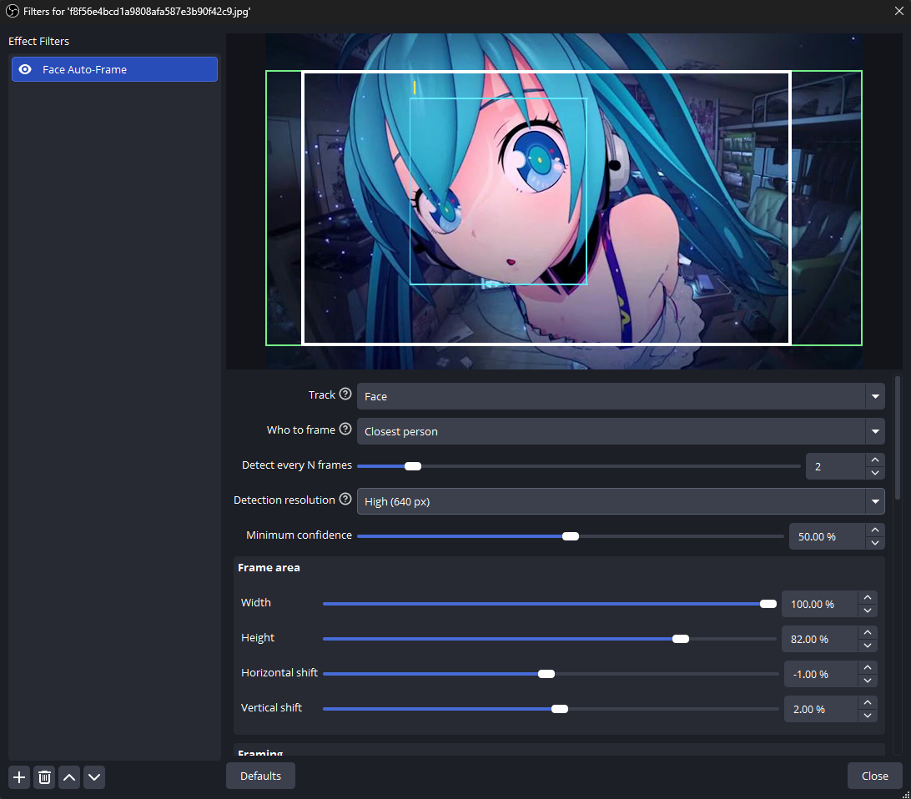

# Face Auto-Frame for OBS Studio



An OBS Studio filter that automatically frames your webcam: it finds your face (or body), zooms in and smoothly
follows you as you move — like "Center Stage" on modern webcams, but for any camera.

Detection runs on the NVIDIA GPU through the NVIDIA AR SDK and the picture never leaves the GPU, so the filter adds
almost no CPU load.

## Features

- **Smooth virtual camera** — critically damped motion (no jerks, no overshoot), separate smoothing for movement and
  zoom, a dead zone that ignores small head movements, optional speed limit and motion prediction. Behaves the same
  at any frame rate.
- **Who to frame** — the closest person, a *locked* person (the first one found; everyone else is ignored until they
  leave), everyone in the picture, or the N largest people. People get stable ids, shown in the debug view.
- **Face or body** tracking, each with its own padding and offset.
- **Frame area** — the camera never shows anything outside it; fully zoomed out it shows exactly this area. Faces are
  only searched inside it. Shift it to "center" an off-center camera.
- **Zoom limits**, padding and offset around the face, configurable behaviour when nobody is found (hold, then zoom
  out or stay).
- **Output size** — same as the webcam or any custom size (e.g. 1080×1920 for vertical streams); the crop always
  keeps the output aspect, so the picture is never stretched.
- **Scaling quality** — Bilinear, Bicubic or Lanczos.
- **Low overhead** — detection on every N-th frame, on a downscaled copy, on a background thread; a frame is simply
  skipped if the previous detection is still running. Nothing is detected while the source is hidden.
- **Debug view** — the whole picture with outlines of detections, tracked people (with ids), the frame area, the target
  and the camera frame, plus detection statistics in the OBS log.
- Recovers from graphics device resets and transient GPU errors; several webcams can use the filter at the same time.
- Every setting has a help tooltip. English and Russian UI.

## Requirements

- Windows 10/11 x64
- OBS Studio **32.0 or newer**, using the Direct3D 11 renderer (default)
- NVIDIA RTX GPU (Turing or newer) — OBS must render on it (check the adapter on laptops with two GPUs)
- **NVIDIA AR SDK redistributable** ("NVIDIA Broadcast AR SDK"), installed from the
  [NVIDIA Broadcast SDK resources page](https://www.nvidia.com/en-us/geforce/broadcasting/broadcast-sdk/resources/).
  Pick the installer for your GPU generation; RTX 50 series needs AR SDK 0.8.7 or newer.

If the SDK or a suitable GPU is missing, the filter still loads, passes the video through unchanged and explains the
problem at the top of its settings.

## Installation

1. Download `obs-face-autoframe-<version>-windows-x64.zip` from the
   [Releases](../../releases) page.
2. Extract it into `C:\ProgramData\obs-studio\plugins\`, so that you get
   `C:\ProgramData\obs-studio\plugins\obs-face-autoframe\bin\64bit\obs-face-autoframe.dll`.
3. Restart OBS.

## Usage

1. Right-click your webcam source → **Filters** → **+** → **Face Auto-Frame**.
2. Enable **Debug view** while setting up: you see the whole picture with all outlines instead of the zoomed image.
3. Adjust the **Frame area**, **Framing** and **Motion** settings, then turn the debug view off.

The debug view is visible in the stream and recordings too — use it only while setting up.

| Debug outline | Meaning |
|---|---|
| Red | Raw detections |
| Green | Frame area |
| Yellow / grey (with id) | Tracked people: framed / ignored |
| Blue | What the camera is framing |
| White | The camera frame (what goes to the output) |

## Building from source

Requirements: Visual Studio 2022 or VS 2022 Build Tools (C++ workload, Windows SDK 10.0.22621 or newer), CMake 3.28+
(bundled with VS / Build Tools), Git.

From a "Developer PowerShell for VS 2022":

```powershell
cmake --preset windows-x64        # first run downloads OBS 32.0.0 sources and dependencies into .deps/
cmake --build --preset windows-x64
cmake --install build_x64 --config RelWithDebInfo --prefix release
```

The plugin is then in `release/obs-face-autoframe/`. Without `--prefix` it installs straight into
`C:\ProgramData\obs-studio\plugins`. The `windows-x64` preset targets Windows SDK 10.0.26100; adjust the version in
`CMakePresets.json` if you have a different one.

The plugin is built against OBS 32.0.0 headers on purpose: OBS refuses plugins built for a newer version than the one
running.

### Tests

The framing logic (tracking, target selection, framing, camera motion) is plain C++ with unit tests that do not need
OBS. They use [Catch2 v3](https://github.com/catchorg/Catch2), which must be available to CMake:

```powershell
cmake -S tests -B build_tests
cmake --build build_tests --config Release
ctest --test-dir build_tests -C Release --output-on-failure
```

### Releases

GitHub Actions builds the plugin for every push and pull request. Pushing a tag like `v0.1.0` creates a draft
release with the plugin zip and a separate zip with debug symbols. The tag version is written into the build
(`buildspec.json` is updated in CI), so local builds keep the version from `buildspec.json`.

## How it works

```
webcam frame ─► capture on GPU ─► downscaled SDR copy ─► NVIDIA AR SDK (worker thread) ─► face/body boxes
                     │                                                                         │
                     │                         tracker ─► who to frame ─► target crop ─► smooth camera
                     ▼                                                                         │
               output = crop of the frame, scaled to the output size  ◄────────────────────────┘
```

Only the detected boxes cross from the GPU to the CPU. The NVIDIA SDK is loaded at runtime, so no SDK files are
shipped with the plugin.

## Acknowledgements

- [StreamFX](https://github.com/Xaymar/obs-StreamFX) auto-framing, which inspired the behaviour and settings.
- [Move transition](https://github.com/exeldro/obs-move-transition) and OBS' own NVIDIA filters, used as references for
  the NVIDIA AR SDK integration.
- [obs-plugintemplate](https://github.com/obsproject/obs-plugintemplate) for the build system.

## License

The plugin source code is licensed under the [MIT License](LICENSE).

- The build scripts in [`cmake/`](cmake) come from
  [obs-plugintemplate](https://github.com/obsproject/obs-plugintemplate) and stay under
  [GPL-2.0](cmake/LICENSE).
- The plugin links against libobs, which is GPL-2.0. MIT is GPL-compatible, but the compiled plugin, as distributed
  together with OBS, is subject to the GPL-2.0 terms of libobs.
